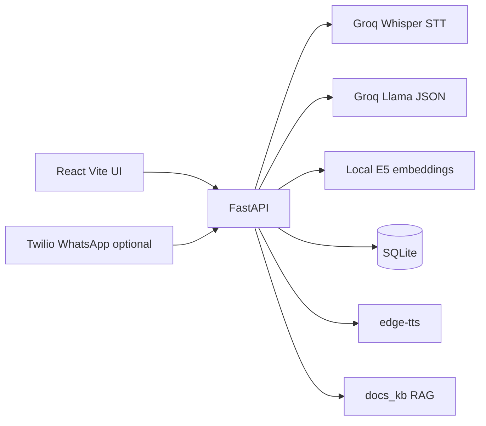
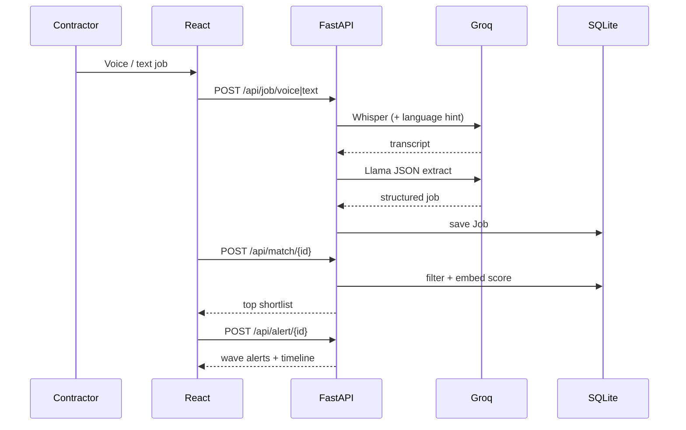

# KaamLink architecture

## Overview

## Job request sequence

## Scoring

`total = 0.5*embedding + 0.25*reliability + 0.15*wage_fit + 0.10*area_match`

## Provider

All cloud LLM/STT calls use **Groq (Whisper + Llama)** only. Embeddings are local `intfloat/multilingual-e5-small`.
